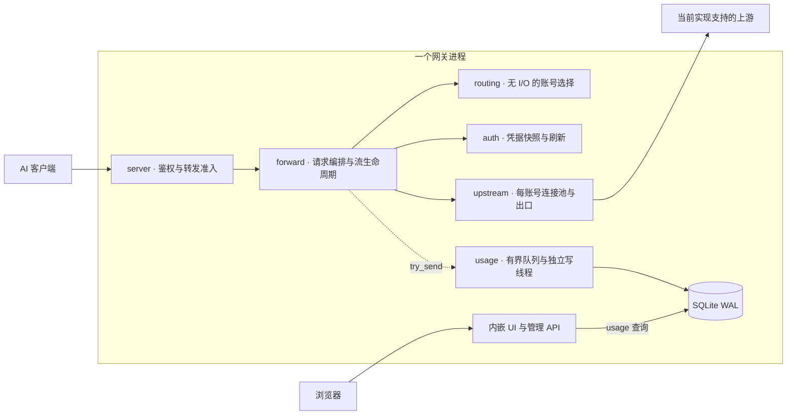

# 架构与演进

本文描述主线源码的职责和行为边界；供应商、客户端与部署能力按实际实现说明。
接口见 [INTERFACES.md](INTERFACES.md)，指标见 [METRICS.md](METRICS.md)，
性能证据见 [PERFORMANCE.md](PERFORMANCE.md)，验证方式见 [TESTING.md](TESTING.md)。
网关与 Agent 的固定版本依据见[研究](RESEARCH.md)，故障和客户端恢复见[恢复边界](RECOVERY.md)。

## 定位与当前判断

ciallopa 的方向是轻量、自托管、流式优先的 AI 网关：一个入口、可解释的账号选择、
清楚的请求结果，以及不需要另外部署监控服务的管理页。单二进制、模块化单体和本地 SQLite
符合目前规模；没有证据要求拆微服务、更换 Tokio/Hyper 或引入分布式存储。

**供应商中立是产品方向，目前实现仍是 Codex 后端适配。** Responses HTTP/SSE、WebSocket、
模型列表和 Images 路径已经有具体实现，但不等于支持任意 OpenAI-compatible 服务或任意厂商。
`upstream` 虽然可配置地址，认证、路径、事件和重试语义仍然绑定当前后端。
下一次扩展应由第二个真实上游验证最小边界，而不是先建立通用插件框架。

核心围绕流生命周期：准备阶段有预算，错误读取有界，准入贯穿响应 Body，停机能够结束等待；
记录、指标和 UI 钻取使用一致且可解释的口径。

## 现有骨架

主转发与本地观测的关系如下。内部模块仍在同一个网关进程中；管理查询不占转发租约，
但与转发共享主机资源。配置和账号管理的具体接口另见接口文档。

下列代码路径均相对 `crates/`。

| 层 | 实现入口 | 保持的职责 |
| --- | --- | --- |
| 服务装配 | `server/src/{lib,main}.rs` | 监听、客户端鉴权、控制面、静态 UI、进程生命周期 |
| 请求编排 | `forward/src/{lib,proxy,ws,images}.rs` | 协议检查、尝试与重放、输出提交、取消及记录 |
| 准入与停机 | `forward/src/admission.rs`、`upstream/src/drain.rs` | 一次操作的共享租约、运行状态、结束等待与强制取消 |
| 路由 | `routing`，`core::Router` | 无网络/磁盘 I/O 的账号选择与结果反馈；绑定、权重、冷却 |
| 上游传输 | `upstream` | 每账号连接池、HTTP/WS、TLS 兼容、出口代理和有限 cookie 状态 |
| 凭据 | `auth`，`core::AccountStore` | 内存快照、账号级刷新、跨进程锁、原子文件写入 |
| 运行配置 | `core::settings::SharedConfig`、`server::settings` | 校验、可替换快照、热更新/重启项、版本校验和审计 |
| 本地记录 | `forward::usage::Tracker` → `usage::Recorder` | 请求/turn 观测、有界队列、独立写线程、SQLite WAL |

请求先鉴权，再在读取大请求体之前获得转发租约，随后准备请求、选账号、取得凭据并发起尝试。
允许重放的错误在输出提交前处理；开始输出后不会将另一账号的回答接在原流后面。
HTTP 租约跟随响应 Body，WS 升级将同一个租约移交给连接任务，不能在 handler 返回响应头时释放。
控制面和数据面职责分开，仍共享同一个进程、runtime 和主机资源。

## 生命周期与资源边界

### 等待、读取与重试

- 每次 HTTP 尝试从发送请求至取得响应头，受 `response_header_timeout_secs` 限制，默认300秒；
  这也包含发送请求体的时间，不只是服务器思考时间。
- `preparation_timeout_secs` 默认600秒，累计覆盖 HTTP 凭据获取、连接/响应头、错误体和重试等待。
  HTTP SSE 前导窗口触发重放时继承剩余预算；读取合法成功流的时间不扣入该预算。
  WS 初始握手另有一个预算，每个 turn 的输出前重连/凭据/退避共享一份新预算；正常生成与帧写入不计入。
  WS 准备超时记为 `preparation_timeout/local`，握手返回504，活动 turn 以1012要求客户端重放。
- HTTP 错误体最多1MiB、绝对读取时间10秒；models 成功体最多8MiB、10秒。
  不完整错误体不会被当作完整上游响应透传；已有上游状态与 request ID 保留在错误元数据中。
  models 缓存另受64个条目、16MiB总正文、5分钟TTL限制。
- 正常响应流继续使用逐 chunk idle timeout，默认300秒；持续有数据的合法长流没有统一的生成倒计时。
  准备预算不是端到端最大时长，也不是 WS 写入无进展的期限。
  HTTP准备、响应头与idle选项在发往上游前一起捕获，贯穿重试和Body，包括Images；
  热更新不会让同一请求在首输出前后突然换用另一idle值。
  WS 在初始握手前捕获 idle 与准备额度，连接内各 turn 沿用；成功重放后重置 idle，废弃连接有界关闭。
- 连接池在锁外构建；热更新期间完成的旧配置构建不会再写回新缓存。
  发布时核对配置并复用已存在的新条目，避免出口或 cookie 设置切换后继续使用迟到的旧客户端。
  每次尝试同时取得client和其实际出口属性，旧连接失败不会按reload后的新出口误分类或错误换号。

重试仍需服从协议状态：`max_attempts` 是特定网络/408/5xx故障的局部预算，
不能解读为所有401、429、账号切换及WS尝试的统一总次数。
无输出也不证明操作没有副作用；加密上下文、增量历史和工具调用仍须保留现有约束。

### 进程准入

`max_inflight_requests` 是可热更新的转发操作上限，默认64，是保守的产品护栏，未由一次压测推导。
HTTP 请求占一个槽直到 Body EOF、错误或丢弃；WS 每个 turn 从客户端请求到终止事件、取消或关闭占一个槽，
空闲 WS 不占槽（连接数只由 `ws_max_connections` 限制），握手本身不占槽。满额时该 turn 收到 503 `gateway_busy`
错误帧、不转发，连接保持，并记为 ws 的 `inflight` 拒绝。没有每客户端 key、每账号公平调度或等待队列。

超额立即返回503、`gateway_busy` 和 `Retry-After: 3`。停机时拒绝新转发为 `shutdown`。
准入只包住 Responses、compact、models、images 及已有透传路由；health、UI、admin和usage查询不占槽。
这使它们不会被同一准入计数挡住，但不保证在CPU、内存或磁盘过载时仍有独立资源。

热降上限不杀已有请求；设0仅关闭拒绝，已有操作仍计数，重新启限时不会漏掉存量。
拒绝发生在 `Tracker` 之前，只有进程累计拒绝数，不伪造某个模型的usage记录。
管理配置API的 `runtime` 返回 `inflight/limit/rejected/ws_connections/draining`，这些不是历史窗口指标。

并发数量不等于字节或RSS上界，HTTP请求体和客户端WS消息另由 `max_buffered_body_mb`（默认256MiB，可热更新）限总字节。
请求体按声明的 `Content-Length` 在读取前预留（chunked按到达量预留），一直占用到所有副本释放：
重试和流内重放共享的 `Bytes`、zstd压缩副本都持有同一预留。没有空间时最多等1秒，再返回与准入相同的503；
返回前读掉并丢弃剩余请求体（最多10秒），避免客户端只看到连接重置。实测进程峰值约为该预算的1.4–2倍。
请求体按 `Content-Length` 预分配，解析出的JSON在压缩前释放；zstd请求体的解压inspection上限等于 `max_body_mb`。
客户端WS消息到达时预留其大小（最多整个预算），因为要留作重放，一直占用到该轮结束；没有空间时最多等1秒，再回一个503 `gateway_busy` 错误帧（`retry-after: 3`），连接保持。
这一预算不限制WS的峰值内存：每个连接的接收与解压缓冲在消息可被计数之前就已存在，上界是 `ws_max_connections`（默认24，超出时握手回503）× `ws_max_message_mb`（默认16MiB，超出时以1009关闭）。
WS握手时还不知道模型，因此选号不带模型；每一轮 `response.create` 到达后按该轮模型重新检查所选账号的按模型冷却：可重放的轮次改连另一个可用账号（或等短冷却），依赖 `previous_response_id` 的轮次以1012关闭让客户端重放，都无可用账号时回一个与HTTP相同的错误帧，连接保持。
图像结果不计入这一预算，SSE通道的16个槽按chunk计数。
Images wrapper的SSE单行与结果收集尚无显式总字节上限，不能把整个进程描述为已具有严格内存界限。

### 停机与取消

SIGTERM/SIGINT停止监听并进入Draining：已有HTTP/SSE最多等待60秒自然结束；
空闲WS正常关闭，活跃WS在当前turn结束后关闭。期限到达或第二次停止信号进入Force：
未返回响应头的工作取消，已经输出的HTTP流截断，WS尝试以1001关闭。
HTTP producer独立监听Force，不依赖慢客户端继续poll；WS被阻塞的send/connect也有强制释放出口。

随后最多留3秒完成关闭，再给usage/指纹flush最多5秒，最后runtime关闭等待2秒。
各阶段约70秒，与Docker/systemd的75秒停机余量衔接；这不是任意调度和外部I/O下的严格墙钟保证。
`spawn_blocking` 超时并不会撤销已经发起的文件写入，最终记录与flush仍是尽力完成，不能承诺持久化成功。
usage writer收到Stop会立即结束批次等待并写出已排队内容；较长的flush间隔不能成为停机时继续空等的理由。

客户端丢弃响应Body时，通道producer会取消，即使上游已经静默也不用等下一块数据。
记录器使用 `try_send`，排队满时计数并丢记录，不让SQLite写入反压转发；查询走blocking路径。

### 记录与页面

请求列表可按完整记录ID查询并用ID游标翻页；固定时间窗加游标是弱一致浏览，不是数据库快照。
概况与趋势复用一次summary，同一时间/账号/模型/密钥/实例范围下继续钻取请求。
失败、取消、incomplete、观察不完整的unknown和预热分开；新TTFT/生成速度字段保留空样本，费用与缓存有明确分母。
超大SSE仍透传，观察不足不再猜测成功或客户端取消；时间桶的usage样本数区分未上报和真实零。

本地记录ID依赖usage开启，计时起点因Responses、Images、WS turn与失败握手而异，详见[METRICS](METRICS.md)。
因此它不是独立的入口trace ID，现有时长也不包含所有入口阶段。失败握手现在保留实际开始时间与等待耗时。
历史非流Responses曾被标成SSE，不能可靠回填；新写入已区分实际HTTP回复。
普通HTTP与Images记录已跟随Body完成、失败和丢弃，不在响应头到达时提前算成功。
HTTP与初始WS握手选中账号后即更新现有Tracker；头前取消保留该候选，尚未选择则为空。
成功WS握手丢弃临时记录，业务仍按turn记录；失败握手不再用排除账号列表猜最终候选。
这不证明凭据已取得或HTTP已发出，也不为未完成的尝试伪造状态码或attempt；
中途取消的尝试链仍受现有返回边界限制，`status=0`在页面显示为未记录状态。
直通Images SSE保留原始事件，仅观察明确的 `event:error` / 顶层 `type:error`，不套用Responses终止规则；
观察缓冲每事件最多64KiB，超限跳到真实事件边界再恢复，转换路径使用自身的结果与错误规则。
Images的Token与首输出仍为未知，不把内部文本模型计量或工具调用次数冒充图像用量。
直通图像事件的业务成功语义尚未逐类解析，传输完成不等于验证每一种图像事件成功。

## 应保留的设计边界

- **保持小型部署。** 控制面与数据面分工，不要求分进程；静态嵌入UI与本地记录可独立使用。
- **路由不做I/O。** 选择基于账号快照、能力和会话状态；凭据刷新与网络调用由编排负责。
  旧请求的成功不能抹掉更新的冷却，已绑定会话不能因优先级变化随意迁移。
- **身份与协议状态不能丢。** 每账号连接池和cookie隔离，保留未知事件/字段；
  不剥离不可解密的上下文来制造表面成功，也不隐式把原生能力转换成有损的统一消息格式。
- **转发负责完整流生命周期。** Body/WS持有准入和取消资源；记录跟随实际终止，输出后的错误有独立语义。
- **观测可以退化，错误必须可见。** usage不是账本；丢记录、缺字段、未定价不伪装成完整或免费。
  请求内容和工具参数不默认进入日志，凭据和客户端key使用脱敏边界。
- **兼容性改动有证据。** 现有Codex网络依赖、TLS/HTTP2/WS构建保留指纹检查；
  不因性能猜测改网络参数。配置写入继续校验版本、生成diff、原子替换和留审计。

## 供应商中立目标与实现的真实差距

目前的crate划分方便维护，但还不是通用provider接口；仅将URL变成数组不会补齐这些差距。

| 边界 | 当前耦合 | 第二个上游必须明确的事情 |
| --- | --- | --- |
| 凭据与账号 | OAuth/导入和刷新围绕Codex；`Account/Credentials`含`chatgpt_account_id`，`AccountStore`包含登录文件语义 | 区分本地客户端key与供应商凭据；支持真实API-key凭据而不伪装成可刷新OAuth账号 |
| 路径与请求 | `/v1/responses`映射到`/codex/responses`，另有wham透传；Images会转为Codex图像路径或Responses工具 | 明确支持的原生端点和必要转换，未支持路径应明确拒绝 |
| 流与会话 | Responses/Codex终止、额度事件、`previous_response_id`和账号绑定加密内容 | 定义该协议的首输出、终止、错误与重放条件；不能只复用HTTP状态判断 |
| 路由与容量 | 通用权重/冷却可复用，但quota窗口、套餐、重置卡带当前供应商语义 | 只向策略提供该上游实际有的状态；缺quota应显示不支持或未知 |
| 模型、用量和费用 | 请求模型/档位用于定价；models缓存以路径/查询为键；token字段来自当前事件格式 | 模型与缓存要有provider身份，用量来源和价格单位逐项映射，不以同名模型假定可互换 |
| 传输与管理页 | 当前网络栈模拟Codex；登录、额度/重置卡UI面向当前账号 | 让兼容参数与账号能力归属具体上游，保留通用请求页，按能力显示专有操作 |

可复用的是准入/取消、连接与出口配置、同步路由、记录查询及通用诊断交互。
当前 `upstream` 也包含协议兼容构建，`core` 也含专有类型；不应因名称通用就把这些全部当成已抽象完成。

## 演进条件

现有结构继续适合个人维护：一个进程、一份本地状态，按职责分 crate；转发不等待日志落盘。
性能方法见 [PERFORMANCE.md](PERFORMANCE.md)。代表性 Linux/TLS 混合负载尚不足，
不由本机短突发调整默认并发、地址族、连接池或传输指纹，也不先加入队列和预聚合。

第二个真实 API-key 上游出现时，先交付一条原生 HTTP/SSE 路径，验证凭据、错误、用量、取消及重放资格。
两个实现的差异稳定后，再决定 adapter trait 或独立 crate。模型缓存、价格和账号能力必须带供应商归属；
未验证的 WS、图像和工具能力不跟随文本路径一起声明支持。

SharedConfig 的原子替换不代表所有阶段使用同一 revision。保持 [SETTINGS.md](SETTINGS.md) 的实际生效边界，
只有具体混用问题才收拢必要快照；不把请求锁成跨组件事务。多副本需要账号刷新所有权、会话归属和状态汇总，
共享 SQLite 卷不能充当协调机制。

SSE/WS 的异常终止日志使用有限事件类型、事件数、活动/事件间隔及已有 ID，独立于 usage 持久化。
时间是应用观察间隔，可能受调度或背压影响；观察不足不能被解释为成功或上游必然漏发终止。
完整定义见 [RECOVERY.md](RECOVERY.md)。不默认记录 prompt、工具参数和模型正文。

UI 保持静态嵌入与原生 keyed 行复用，按实际维护和交互成本决定组件化，见 [UI.md](UI.md)。
验证保持小型：改变哪条契约就验证哪条契约，整批通过共享 gate，见 [TESTING.md](TESTING.md)。
