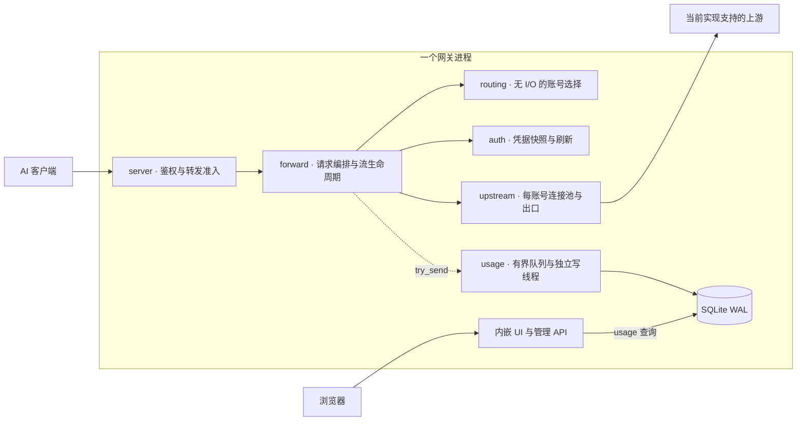

# 架构审视与演进方向

审视日期：2026-10-23。本文描述当前源码的边界及下一轮取舍，不把路线图当成已支持能力。
接口见 [INTERFACES.md](INTERFACES.md)，指标见 [METRICS.md](METRICS.md)，
性能证据见 [PERFORMANCE.md](PERFORMANCE.md)，验证方式见 [TESTING.md](TESTING.md)。

## 定位与当前判断

ciallopa 的方向是轻量、自托管、流式优先的 AI 网关：一个入口、可解释的账号选择、
清楚的请求结果，以及不需要另外部署监控服务的管理页。单二进制、模块化单体和本地 SQLite
符合目前规模；没有证据要求拆微服务、更换 Tokio/Hyper 或引入分布式存储。

**供应商中立是产品方向，目前实现仍是 Codex 后端适配。** Responses HTTP/SSE、WebSocket、
模型列表和 Images 路径已经有具体实现，但不等于支持任意 OpenAI-compatible 服务或任意厂商。
`upstream` 虽然可配置地址，认证、路径、事件和重试语义仍然绑定当前后端。
下一次扩展应由第二个真实上游验证最小边界，而不是先建立通用插件框架。

本轮已补上 HTTP 准备阶段预算、错误体界限、贯穿响应 Body 的进程准入和有界停机，
也让记录、指标和 UI 钻取使用明确口径。剩余工作应从实际未覆盖路径和使用需求出发，
不用完整 tracing 平台或大量配置旋钮作为“架构完善”的前提。

## 现有骨架

主转发与本地观测的关系如下。内部模块仍在同一个网关进程中；管理查询不占转发租约，
但与转发共享主机资源。配置和账号管理的具体接口另见接口文档。

下列代码路径均相对 `crates/`。

| 层 | 实现入口 | 保持的职责 |
| --- | --- | --- |
| 服务装配 | `server/src/{lib,main}.rs` | 监听、客户端鉴权、控制面、静态 UI、进程生命周期 |
| 请求编排 | `forward/src/{lib,proxy,ws,images}.rs` | 协议检查、尝试与重放、输出提交、取消及记录 |
| 准入与停机 | `forward/src/admission.rs`、`upstream/src/drain.rs` | 一次操作的共享租约、运行状态、结束等待与强制取消 |
| 路由 | `routing`，`core::Router` | 无网络/磁盘 I/O 的账号选择与结果反馈；绑定、权重、冷却 |
| 上游传输 | `upstream` | 每账号连接池、HTTP/WS、TLS 兼容、出口代理和有限 cookie 状态 |
| 凭据 | `auth`，`core::AccountStore` | 内存快照、账号级刷新、跨进程锁、原子文件写入 |
| 运行配置 | `core::settings::SharedConfig`、`server::settings` | 校验、可替换快照、热更新/重启项、版本校验和审计 |
| 本地记录 | `forward::usage::Tracker` → `usage::Recorder` | 请求/turn 观测、有界队列、独立写线程、SQLite WAL |

请求先鉴权，再在读取大请求体之前获得转发租约，随后准备请求、选账号、取得凭据并发起尝试。
允许重放的错误在输出提交前处理；开始输出后不会将另一账号的回答接在原流后面。
HTTP 租约跟随响应 Body，WS 升级将同一个租约移交给连接任务，不能在 handler 返回响应头时释放。
控制面和数据面职责分开，仍共享同一个进程、runtime 和主机资源。

## 本轮已成立的边界

### 等待、读取与重试

- 每次 HTTP 尝试从发送请求至取得响应头，受 `response_header_timeout_secs` 限制，默认300秒；
  这也包含发送请求体的时间，不只是服务器思考时间。
- `preparation_timeout_secs` 默认600秒，累计覆盖 HTTP 凭据获取、连接/响应头、错误体和重试等待。
  HTTP SSE 前导窗口触发重放时继承剩余预算；读取合法成功流的时间不扣入该预算。
- HTTP 错误体最多1MiB、绝对读取时间10秒；models 成功体最多8MiB、10秒。
  不完整错误体不会被当作完整上游响应透传；已有上游状态与 request ID 保留在错误元数据中。
  models 缓存另受64个条目、16MiB总正文、5分钟TTL限制。
- 正常响应流继续使用逐 chunk idle timeout，默认300秒；持续有数据的合法长流没有统一的生成倒计时。
  准备预算不是端到端最大时长，也尚未统一到 WS 握手/turn 的现有重试流程。
  HTTP准备、响应头与idle选项在发往上游前一起捕获，贯穿重试和Body，包括Images；
  热更新不会让同一请求在首输出前后突然换用另一idle值。
- 连接池在锁外构建；热更新期间完成的旧配置构建不会再写回新缓存。
  发布时核对配置并复用已存在的新条目，避免出口或 cookie 设置切换后继续使用迟到的旧客户端。
  每次尝试同时取得client和其实际出口属性，旧连接失败不会按reload后的新出口误分类或错误换号。

重试仍需服从协议状态：`max_attempts` 是特定网络/408/5xx故障的局部预算，
不能解读为所有401、429、账号切换及WS尝试的统一总次数。
无输出也不证明操作没有副作用；加密上下文、增量历史和工具调用仍须保留现有约束。

### 进程准入

`max_inflight_requests` 是可热更新的转发操作上限，默认64，是保守的产品护栏，未由一次压测推导。
HTTP 请求占一个槽直到 Body EOF、错误或丢弃；WS 从握手到整条连接关闭占一个槽，空闲WS也计数。
它不是活跃 turn 上限，也没有每客户端 key、每账号公平调度或等待队列。

超额立即返回503、`gateway_busy` 和 `Retry-After: 1`。停机时拒绝新转发为 `shutdown`。
准入只包住 Responses、compact、models、images 及已有透传路由；health、UI、admin和usage查询不占槽。
这使它们不会被同一准入计数挡住，但不保证在CPU、内存或磁盘过载时仍有独立资源。

热降上限不杀已有请求；设0仅关闭拒绝，已有操作仍计数，重新启限时不会漏掉存量。
拒绝发生在 `Tracker` 之前，只有进程累计拒绝数，不伪造某个模型的usage记录。
管理配置API的 `runtime` 返回 `inflight/limit/rejected/ws_connections/draining`，这些不是历史窗口指标。

并发数量不等于字节或RSS上界。请求体默认实际16MiB；解压后的JSON inspection最多读取256MiB，
WS消息及图像结果另有大小成本，SSE通道的16个槽按chunk计数。
Images wrapper的SSE单行与结果收集尚无显式总字节上限，不能把整个进程描述为已具有严格内存界限。

### 停机与取消

SIGTERM/SIGINT停止监听并进入Draining：已有HTTP/SSE最多等待60秒自然结束；
空闲WS正常关闭，活跃WS在当前turn结束后关闭。期限到达或第二次停止信号进入Force：
未返回响应头的工作取消，已经输出的HTTP流截断，WS尝试以1001关闭。
HTTP producer独立监听Force，不依赖慢客户端继续poll；WS被阻塞的send/connect也有强制释放出口。

随后最多留3秒完成关闭，再给usage/指纹flush最多5秒，最后runtime关闭等待2秒。
各阶段约70秒，与Docker/systemd的75秒停机余量衔接；这不是任意调度和外部I/O下的严格墙钟保证。
`spawn_blocking` 超时并不会撤销已经发起的文件写入，最终记录与flush仍是尽力完成，不能承诺持久化成功。

客户端丢弃响应Body时，通道producer会取消，即使上游已经静默也不用等下一块数据。
记录器使用 `try_send`，排队满时计数并丢记录，不让SQLite写入反压转发；查询走blocking路径。

### 记录与页面

请求列表可按完整记录ID查询并用ID游标翻页；固定时间窗加游标是弱一致浏览，不是数据库快照。
概况与趋势复用一次summary，同一时间/账号/模型/密钥/实例范围下继续钻取请求。
失败、取消、incomplete和预热分开；新TTFT/生成速度字段保留空样本，费用与缓存有明确分母。

本地记录ID依赖usage开启，`Tracker`通常在请求体提取与JSON检查之后开始，
因此它不是独立的入口trace ID，现有时长也不包含所有入口阶段。
历史非流Responses曾被标成SSE，不能可靠回填；新写入已区分实际HTTP回复。
普通HTTP与Images记录已跟随Body完成、失败和丢弃，不在响应头到达时提前算成功。
HTTP选中账号后即更新现有Tracker；头前取消保留该候选，尚未选择则为空。
这不证明凭据已取得或HTTP已发出，也不为未完成的尝试伪造状态码或attempt；
中途取消的尝试链仍受现有返回边界限制，`status=0`在页面显示为未记录状态。
直通Images SSE保留原始事件，不套用Responses终止规则；转换路径使用自身的结果与错误规则。
Images的Token与首输出仍为未知，不把内部文本模型计量或工具调用次数冒充图像用量。
直通图像事件的业务成功语义尚未逐类解析，传输完成不等于验证每一种图像事件成功。

## 应保留的设计边界

- **保持小型部署。** 控制面与数据面分工，不要求分进程；静态嵌入UI与本地记录可独立使用。
- **路由不做I/O。** 选择基于账号快照、能力和会话状态；凭据刷新与网络调用由编排负责。
  旧请求的成功不能抹掉更新的冷却，已绑定会话不能因优先级变化随意迁移。
- **身份与协议状态不能丢。** 每账号连接池和cookie隔离，保留未知事件/字段；
  不剥离不可解密的上下文来制造表面成功，也不隐式把原生能力转换成有损的统一消息格式。
- **转发负责完整流生命周期。** Body/WS持有准入和取消资源；记录跟随实际终止，输出后的错误有独立语义。
- **观测可以退化，错误必须可见。** usage不是账本；丢记录、缺字段、未定价不伪装成完整或免费。
  请求内容和工具参数不默认进入日志，凭据和客户端key使用脱敏边界。
- **兼容性改动有证据。** 现有Codex网络依赖、TLS/HTTP2/WS构建保留指纹检查；
  不因性能猜测改网络参数。配置写入继续校验版本、生成diff、原子替换和留审计。

## 供应商中立目标与实现的真实差距

目前的crate划分方便维护，但还不是通用provider接口；仅将URL变成数组不会补齐这些差距。

| 边界 | 当前耦合 | 第二个上游必须明确的事情 |
| --- | --- | --- |
| 凭据与账号 | OAuth/导入和刷新围绕Codex；`Account/Credentials`含`chatgpt_account_id`，`AccountStore`包含登录文件语义 | 区分本地客户端key与供应商凭据；支持真实API-key凭据而不伪装成可刷新OAuth账号 |
| 路径与请求 | `/v1/responses`映射到`/codex/responses`，另有wham透传；Images会转为Codex图像路径或Responses工具 | 明确支持的原生端点和必要转换，未支持路径应明确拒绝 |
| 流与会话 | Responses/Codex终止、额度事件、`previous_response_id`和账号绑定加密内容 | 定义该协议的首输出、终止、错误与重放条件；不能只复用HTTP状态判断 |
| 路由与容量 | 通用权重/冷却可复用，但quota窗口、套餐、重置卡带当前供应商语义 | 只向策略提供该上游实际有的状态；缺quota应显示不支持或未知 |
| 模型、用量和费用 | 请求模型/档位用于定价；models缓存以路径/查询为键；token字段来自当前事件格式 | 模型与缓存要有provider身份，用量来源和价格单位逐项映射，不以同名模型假定可互换 |
| 传输与管理页 | 当前网络栈模拟Codex；登录、额度/重置卡UI面向当前账号 | 让兼容参数与账号能力归属具体上游，保留通用请求页，按能力显示专有操作 |

可复用的是准入/取消、连接与出口配置、同步路由、记录查询及通用诊断交互。
当前 `upstream` 也包含协议兼容构建，`core` 也含专有类型；不应因名称通用就把这些全部当成已抽象完成。

## 下一轮最值得做的四件事

### 1. 测量大请求与慢消费者的字节成本

本轮已修复普通HTTP和Images的完成、晚错误、取消与停机记录，并验证确定为空的Body不会误记取消。
也去除了图像收集器对无用文本/推理对象的保留及完成数组复制；有限合成探针中，
异常多结果流的最高阶段RSS减少约7.4MiB，取消仍释放槽位，详见性能报告。
追加的4并发实验使用256KiB/1MiB合成JSON与12MiB输出，观察到准备阶段RSS约28/40–41MiB，
暂停消费者确实阻塞上游写入，主动取消仍正确释放名额；没有发现必须立即改实现的问题。
后续应以实际上下文、合规图像数量和更长慢消费者为负载，沿SSE行缓冲、收集结果和WS消息测量；
这些有限输入、单轮观察不能代替部署容量验证，也不能拆分同步JSON解析与压缩成本。
现有数量准入可以限制同时进行的操作，但不能代替这些测量。
只有发现不可接受的资源增长，再确定协议允许的大小边界或受控blocking工作；
不把图像首输出混入文本TPS，也不因预想风险添一排配置旋钮。

### 2. 让一次请求的配置和排障说明一致

`SharedConfig`可原子替换，但现有helpers多次 `load()`，并非所有阶段已经持有同一revision。
本轮已让HTTP三项超时沿用同一快照，并通过运行中请求跨reload验证；
其余路由、出口和错误策略的当前生效边界详见 [SETTINGS.md](SETTINGS.md)。
后续只有出现具体不一致再收拢必要选项，不把整个请求锁成一个跨组件事务。

排障先复用已有记录ID、上游ID和尝试链。HTTP/SSE超时、缺终止EOF及WS活动turn的传输错误/idle
警告已附当前记录ID，HTTP同时保留已有上游ID；可以由日志定位请求页，无需增加日志条数。
记录异步落盘且可能丢弃，日志出现ID不承诺该记录一定可查；其余路径按实际排障需求补齐。
确有usage关闭时排障需求，再增入口关联ID并说明响应头协议；无需先引入大而全的RequestContext、
traceparent传播或各阶段直方图。多实例全局ID与可选OTel导出留到实际使用场景出现。

### 3. 有第二个真实上游需求时，再验证最小供应商边界

选择一个实际要用的API-key上游，先交付一条明确的HTTP/SSE请求路径：凭据注入、路径、错误、
用量提取、取消与重放资格。没有验证的WS、图片或工具能力先不声称支持。
先在现有模块中收拢两套实现真正不同的函数与类型，再决定是否需要独立adapter trait或crate。

完成标准是两个上游分别保留原生字段/事件，HTTP200流内错误能正确分类，
取消和超时按同一生命周期结束；账号、模型缓存和费用不会跨供应商误用。
保留当前Codex协议fixtures，不能用“兼容OpenAI格式”代替真实协议测试。

### 4. 让下一次优化有可重复证据

本次1m合成记录的30天summary约344ms、查询进程峰值约43MiB；首页51条约0.24ms。
临时索引只明显改善单条件count，并未普遍改善summary；已经消除概况/趋势的重复查询，暂不预聚合。
这些是release、WSL2、tmpfs暖缓存结果，不代表低配VPS或持久磁盘，详见性能报告。

早期网络32/64/128短流基线缺少直连mock对照，不能据此承诺容量或证明默认64是最佳配置。
本轮补充固定payload和持续时间的32/64直连、usage开/关对照，并独立记录mock与网关资源。
单请求预热后的首次64并发突发明显慢于直连；同一实例第二轮首输出p50约108ms，接近直连107ms。
差异主要出现在首次扩张阶段，usage开/关没有一致延迟差异，不能解读为稳态每请求开销。
临时配置与socket探针将主要成本缩小到本机显式IPv4临时端口bind；它不代表所有Linux/WSL2环境，
真实TLS链路尚未复验，因此保留现有兼容参数，不用本机结果直接改变地址族策略。
本轮已追加有限的大输入与真实背压观察；后续按实际需要扩大输入分布、持续时间并加入查询争用。
需要评估过载时再加入开放到达率，记录拒绝与全部失败，不只看成功p99。

可重复脚本已使用独立临时目录、保存自身进程句柄并核对退出，不依赖旧`/tmp`状态或宽泛pkill。
同步压缩/解析和凭据文件I/O是否值得迁往受控blocking路径，由这组混合负载决定；
不把全部工作送入无界队列，也不因一次测试预设通用吞吐或RSS阈值。

## 业界变化如何影响这里的取舍

2026-10-23重新读取官方资料，而不是沿用竞品旧名称或能力印象。
Envoy AI Gateway的旧网站与仓库均已重定向到 **Agent Router**；官方2026-09-09
[公告](https://theagentrouter.ai/blog/envoy-ai-gateway-is-now-agent-router/)说明名称与所属基金会变化，
现有部署API保持兼容。以下Agent Router资料为1.2版本；Cloudflare路由页更新于2026-10-02，
日志/成本页更新于2026-09-24。它们反映具体产品选择，不代表整个行业已经只有一种正确架构。

| 已核实的变化 | 对ciallopa有价值的方向 | 什么时候值得继续做 |
| --- | --- | --- |
| 原生协议与统一路由入口并存。Cloudflare的[Dynamic Routing](https://developers.cloudflare.com/ai-gateway/features/dynamic-routing/)仅接受Chat Completions形状，Anthropic Messages会返回400。 | 分别说明透传、协议转换、原生WS与Images语义，供应商数量不能代替兼容性。 | 确有第二上游或新客户端，拿到脱敏成功/失败样本后交付一条完整路径，再抽取共同部分。 |
| [Agent Router指标](https://theagentrouter.ai/docs/capabilities/observability/metrics/)将duration延续到Body处理完成，单列首输出与token间延迟；[Cloudflare成本](https://developers.cloudflare.com/ai-gateway/observability/costs/)依赖模型及token数据，只是估算。 | 保持完成、断流和取消的真实边界，缺样本为空；明确当前计时不覆盖入口读Body。 | 现有记录确实无法区分本地等待与慢上游，再增加一个明确阶段时间；图像计量有真实schema与价格依据后再展示。 |
| [Agent Router数据面](https://theagentrouter.ai/docs/concepts/architecture/data-plane/)把供应商鉴权与转换放在每次upstream attempt，解释Envoy retry不会重走router filter；Cloudflare路由有版本与回滚。 | 先保证attempt链、共享准备预算、输出提交后的重放限制与配置生效边界可解释。 | 一组真实路由规则需要整体回滚时，再引入小范围revision；目前不用路由DAG或条件语言替代现有明确策略。 |
| Cloudflare区分[原生实时与非实时WS](https://developers.cloudflare.com/ai-gateway/usage/websockets-api/)；[非实时入口](https://developers.cloudflare.com/ai-gateway/usage/websockets-api/non-realtime-api/)使用`universal.create/stream/done`自有封装和eventId/logId。 | 保持原生Responses WS、整连接占槽、每turn记录的区别，不能把“支持WS”解释为所有实时协议互通。 | 真实空闲长连接造成容量拒绝时再评估turn级准入；有语音客户端需求时再验证其原生协议。 |
| Agent Router既有[控制面/数据面分层](https://theagentrouter.ai/docs/concepts/architecture/system-architecture/)，也提供无Kubernetes/Docker的[本地运行](https://theagentrouter.ai/docs/getting-started/)；Cloudflare[日志](https://developers.cloudflare.com/ai-gateway/observability/logging/)可分开保存metadata与payload。 | 保留单二进制、本地配置与有限请求元数据，使用轻部署和可解释诊断的收益。 | 多实例配置协调成为实际问题才增加控制面；单条详情不足以离线排障时再补小型脱敏导出。 |

没有调用这些产品的真实上游API。Agent Router端点矩阵的总表与分节存在不一致，
因此不将竞品文档清单当成已验证兼容性的证据。对本项目，网络层改动仍需实际部署的连接复用、
TLS与代表性负载对照；增加代理层、缓存或排队之前，应先指出它解决的具体等待与成本。

## 参考与维护约束

以下沿用本轮已核实的官方资料，不将竞品能力列表变成当前项目的必做清单：

- [Grafana dashboard best practices](https://grafana.com/docs/grafana/latest/visualizations/dashboards/build-dashboards/best-practices/)：用少量指标回答问题，再按同一范围钻取；无需先部署Grafana。
- [LiteLLM fallbacks](https://docs.litellm.ai/docs/proxy/reliability)：重试、fallback和cooldown需分层解释；跨凭据上下文策略不能照搬。
- [OpenTelemetry GenAI](https://github.com/open-telemetry/semantic-conventions-genai)：区分流式事件、客户端时间和服务端token指标；Development约定适合隔离映射，不直接固化内部schema。
- [SQLite query planning](https://www.sqlite.org/queryplanner.html)：根据实际过滤和执行计划选择索引，结合写入成本验证；具体实验见性能报告。

当前架构不要求OTel Collector、分布式预算、动态路由编辑器、语义缓存或MCP执行框架。
多实例出现真实需求后，再设计会话归属、冷却协调、全局ID和事件导出；
不同 `instance_id` 不能保证多进程记录ID不冲突，共享一个WAL文件也不等于水平扩展。

开发和CI检查以 [TESTING.md](TESTING.md) 为准；历史通过结果不代表当前checkout已经全通过。
Docker实际构建/smoke与传输锁文件差异是独立的维护事项。
许可已按维护者选择统一为MIT，README与 `LICENSE` 一致。
